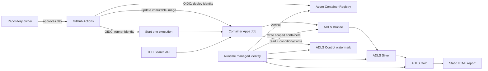

# Architecture and trust boundaries

TenderScope is a run-oriented batch pipeline. It separates application deployment, ETL execution and data-plane access so no single GitHub identity receives every permission.

## Component view

## Pipeline lifecycle

1. The user chooses a completed historical date window in `Run ETL dev`.
2. The protected `dev` environment pauses the job until the repository owner approves it.
3. GitHub validates the date window (at most seven days) and page limit (1–100).
4. GitHub exchanges its OIDC token for a short-lived Azure token. No Azure client secret is stored.
5. The runner identity starts one Container Apps Job execution with the selected dates.
6. The job fetches TED pages and writes an atomic Bronze manifest.
7. Polars creates normalized Silver datasets.
8. DuckDB runs eight quality checks. Any failure stops publication.
9. Polars creates Gold summaries and a self-contained HTML report.
10. The runtime identity reserves the run ID, uploads all layers and writes Silver `_SUCCESS.json`.
11. The job conditionally advances the versioned Control watermark using the ETag read at startup.

## Data contracts

| Layer | Files | Contract |
| --- | --- | --- |
| Bronze | `manifest.json`, `page_*.json` | Raw API evidence, versioned manifest, query, pagination state, timestamps and page counts |
| Silver | `notice.parquet`, `notice_buyer.parquet`, `notice_cpv.parquet` | Typed analytical tables with uniqueness and referential checks |
| Gold | four summary Parquet files, `summary.json`, `report.html` | Run-level KPIs for dates, buyers, CPV codes and notice types |
| Completion | `silver/.../_SUCCESS.json` | Written only after Bronze, Silver and Gold uploads complete |
| Control | `state/<stream>.json` | Versioned last-completed date, run ID and UTC update timestamp |

The run identifier is UTC-based (`ted_YYYYMMDDTHHMMSSffffffZ`). All three layers use the same identifier, which makes a batch traceable without a separate orchestration database.

## Identity and permission model

| Identity | Used by | Allowed | Explicitly not required |
| --- | --- | --- | --- |
| Deployment identity | `Deploy dev` | Push to ACR; read and update the existing job | Start/delete job, read job secrets, access ADLS, assign roles |
| Runner identity | `Run ETL dev` | Read the existing job, start one execution and inspect execution state | Update/delete job, stop executions, push images, access ADLS |
| Runtime identity | Container Apps Job | Pull its image; write Bronze, Silver and Gold; read/conditionally write Control state | Push images, deploy infrastructure, assign roles |

GitHub federation is restricted to the repository's protected `dev` environment. The workflows also restrict execution to `main` and request only `contents: read` plus `id-token: write` where Azure login is required.

## Failure semantics

- A failed API request is retried for transient network errors, throttling and server errors.
- Page data and the manifest are written atomically.
- An interrupted ingestion can resume from its stored continuation token.
- An incomplete page-limited run is rejected unless partial processing was explicitly allowed.
- A failed Silver quality check prevents Gold creation and cloud publication.
- `_SUCCESS.json` is the consumer-facing completion marker; the presence of individual files alone is not success.
- A watermark advances only after `_SUCCESS.json`; gaps, overlaps, future days and stale ETags are rejected.
- A crash between `_SUCCESS` and the watermark is at-least-once: data may be republished, but progress is never skipped.
- GitHub waits for the Azure execution's terminal state and marks the workflow failed unless Azure reports `Succeeded`.

## Cost and scope decisions

- The Container Apps Job uses a manual trigger and the Consumption workload profile.
- There is no scheduler, always-on compute, hosted BI service or analytical database.
- A static HTML report avoids dashboard hosting cost.
- The dev job uses 0.5 vCPU, 1 GiB memory and a 30-minute execution timeout.
- ACR uses Basic, Storage uses Standard LRS and Log Analytics retains 30 days.

These decisions are appropriate for a portfolio environment. A production service would additionally need proactive alerting, retention policies, service objectives and an approved manual state-repair procedure.

See [data contracts](data-contracts.md) for compatibility, metric definitions and historical correction limitations.

## Historical analysis

The local history builder reads only batches named by a reviewed catalog. It validates complete date coverage, source contracts and notice IDs before rebuilding historical tables and Gold summaries. Corrections replace an entire selected window. Outputs carry source run IDs and hashes; old snapshots remain unchanged. See [historical selection](history.md) for the commands and limitations.
