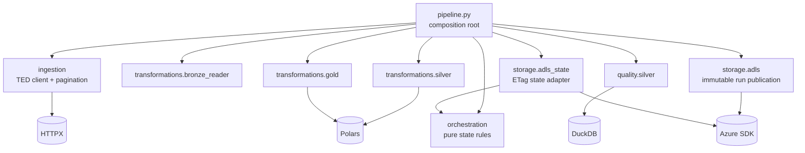
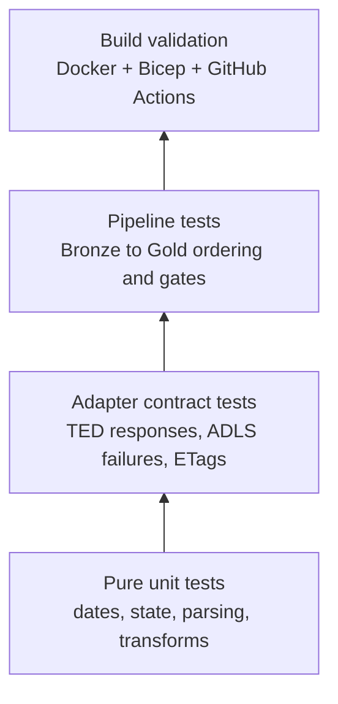

# Codebase structure and dependency rationale

TenderScope keeps domain rules separate from external systems. The command-line pipeline is the composition root: it connects pure date/state rules, HTTP ingestion, transformations, quality checks and Azure adapters.

## Module dependency map

The dependency direction is deliberate:

- `orchestration.state` imports no Azure SDK code and can be tested as a deterministic domain module;
- `storage.adls_state` translates that domain contract to ADLS reads and conditional writes;
- transformations do not authenticate, deploy resources or choose date windows;
- the pipeline coordinates steps but does not contain TED pagination, SQL quality rules or storage serialization details;
- infrastructure code grants capabilities, while application code still enforces ordering and ETag concurrency.

## Runtime dependencies

| Dependency | Responsibility | Why it is used here |
| --- | --- | --- |
| HTTPX | TED API transport | Explicit timeouts, testable mock transport and predictable error handling |
| Polars | Silver and Gold transformations | Typed columnar operations and efficient Parquet output without a distributed runtime |
| DuckDB | Relational quality gate | SQL assertions over Parquet, including uniqueness and referential integrity |
| Azure Identity | Workload authentication | `DefaultAzureCredential` supports the Container Apps managed identity without secrets |
| Azure Data Lake SDK | Data and control persistence | ADLS directories, uploads, ETags and conditional writes through the native data plane |
| uv | Environment and lockfile | Reproducible dependency resolution and fast CI/local setup |

Spark, an orchestrator database and a hosted BI service are intentionally absent. The bounded data volume does not justify their cost or operational surface. The architecture can add them later behind existing layer and state contracts if scale or service objectives require it.

## Test strategy

- Pure tests cover window resolution, state schema versions and transitions.
- Fake ADLS clients exercise missing state, create conflicts and stale ETags without cloud credentials.
- HTTPX mock transports exercise pagination, retry and end-to-end pipeline behavior.
- Pipeline tests verify that state commits only after successful publication.
- CI runs Ruff, pytest, Docker build and Bicep compilation on every pull request.
- A manually approved Azure run remains the final integration check because it changes external state and may incur cost.

## Change boundaries

| Change | Primary module | Expected verification |
| --- | --- | --- |
| TED request or pagination | `ingestion/` | response-shape, retry, resume and page tests |
| Silver schema | `transformations/silver.py` | transform tests, DuckDB checks and compatibility policy |
| New KPI or report visual | `transformations/gold.py` | model, empty-data and HTML tests |
| Date/window policy | `orchestration/state.py` | pure transition and edge-case tests |
| ADLS behavior | `storage/` | adapter tests plus approved cloud smoke test |
| Permissions or resources | `infra/` | Bicep build, `what-if`, reviewed deployment |
| Deployment or execution | `.github/workflows/` | CI syntax/build checks and protected `dev` approval |

This separation keeps changes reviewable and prevents a data-model edit from silently changing deployment permissions or orchestration progress.
