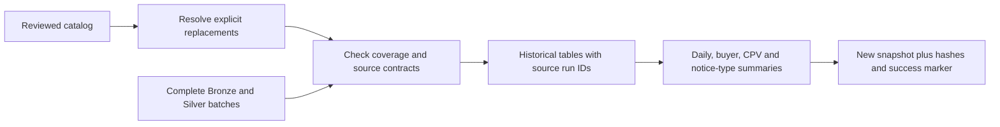

# Building history from reviewed batches

A successful ETL run is not automatically the version that should appear in a historical report. Two successful runs can cover the same dates. Adding both would double-count notices; selecting the newest timestamp would hide a business decision inside file ordering.

TenderScope uses a small JSON catalog reviewed with the code. It names the accepted runs and their date windows. `catalogs/dev-history.json` starts with the verified batches for 12–14 November 2026. It is a three-day example, not a complete history of Polish procurement.

## Selection rules

- Every day between the catalog's `since` and `until` must be covered exactly once by an active batch.
- Only complete Bronze runs with a matching Silver completion marker are eligible. The query must match the catalog's dates and the Polish IT stream exactly.
- Silver schemas and the eight quality checks run again. Notice IDs must agree with Bronze, and publication dates must fall inside the selected window.
- A notice ID appearing in two accepted windows stops the build. The tool does not guess which row is newer or silently drop duplicates.
- A correction names the active earlier run in `supersedes` and must cover that entire window. Old rows and relationships disappear from the current snapshot, including when the replacement is empty.
- The catalog keeps the superseded entries and the reason for each selection. They are audit records, not additional input rows.

A partial correction to a multi-day window is deliberately unsupported. Re-extract the entire original window. This keeps selection predictable without implementing a general-purpose versioned data warehouse.



## Build the verified example

Run from the repository root. Authenticate with an identity that can read the selected containers. Downloading these files does not start ETL, update the watermark or modify Azure data; storage reads can still incur normal transaction charges.

```powershell
uv run python -m tenderscope.history_download `
  --catalog catalogs/dev-history.json `
  --storage-account sttenderscope123123 `
  --destination data/history-inputs/nov12-14

uv run python -m tenderscope.history `
  --catalog catalogs/dev-history.json `
  --source-root data/history-inputs/nov12-14 `
  --output data/history/nov12-14
```

Both destinations must be new directories. An interrupted download is retried into a new directory. To rebuild from the same downloaded inputs, keep `--source-root` and choose another `--output`.

The input layout mirrors the containers: `bronze/<prefix>/<run_id>/` and `silver/<prefix>/<run_id>/`. The downloader fetches only active catalog entries. It needs the Bronze manifest/pages, the three Silver files and the completion marker; it does not need old Gold reports.

## Outputs and meaning

| File | Grain / purpose |
| --- | --- |
| `notice.parquet` | One row per publication number, plus `source_run_id` and `source_prefix` |
| `notice_buyer.parquet` | One notice–buyer-name pair, with the same provenance |
| `notice_cpv.parquet` | One notice–CPV pair, with the same provenance |
| `daily_summary.parquet` | One row per covered date, including complete days with zero notices |
| `buyer_summary.parquet` | Counts by distinct buyer-name strings, not resolved organizations |
| `cpv_summary.parquet` | Counts by CPV; a notice can appear under several codes |
| `notice_type_summary.parquet` | Counts by notice type |
| `catalog.json` | Exact selection used for this snapshot |
| `_SUCCESS.json` | Selected runs, catalog/input/output SHA-256 hashes, date range and record count |

Consumers use only directories with `_SUCCESS.json`. The marker is written atomically after every output file. A disk/write failure can leave an incomplete directory; it is not a valid snapshot. Existing snapshots are never overwritten.

Hashes let a reviewer compare the exact inputs used by two snapshots. They do not prove that the source was correct or prevent an administrator from changing files. Identical catalog and input bytes produce the same logical result; dependency versions are locked in `uv.lock`.

## Review a correction

Keep the original entry, then append a replacement like this (illustrative IDs):

```json
{
  "run_id": "ted_corrected",
  "prefix": "corrections/review-42",
  "since": "2026-11-12",
  "until": "2026-11-12",
  "supersedes": "runs/ted_original",
  "reason": "Reviewed missing notices in the original extraction; see PR 42."
}
```

Before merging a catalog change, compare added/removed IDs and changed fields with the original batch. The `reason` field records the decision; it is not an authorization mechanism. Approval happens in the PR review. The history builder never changes the incremental watermark.

## Verification and limits

On 16 November 2026 the local builder read three existing Azure batches and produced 53 distinct publication IDs: 27 on 12 November, 26 on 13 November and zero on 14 November. All three batches passed the quality gate again. No cloud ETL or infrastructure changes were needed.

Tests exercise explicit replacements, deletion through empty replacements, date gaps, overlaps, repeated IDs, partial runs, wrong queries, schema drift, provenance, input mutation and incomplete output writes.

This is a current accepted view with retained batch provenance, not SCD Type 2 or a complete record of upstream changes. It does not discover late arrivals automatically, infer procurement-procedure identity, resolve buyer organizations or publish a BI service. It builds in memory and is intended for bounded portfolio data. Power BI can be added on top of these tables after choosing the reporting model.
