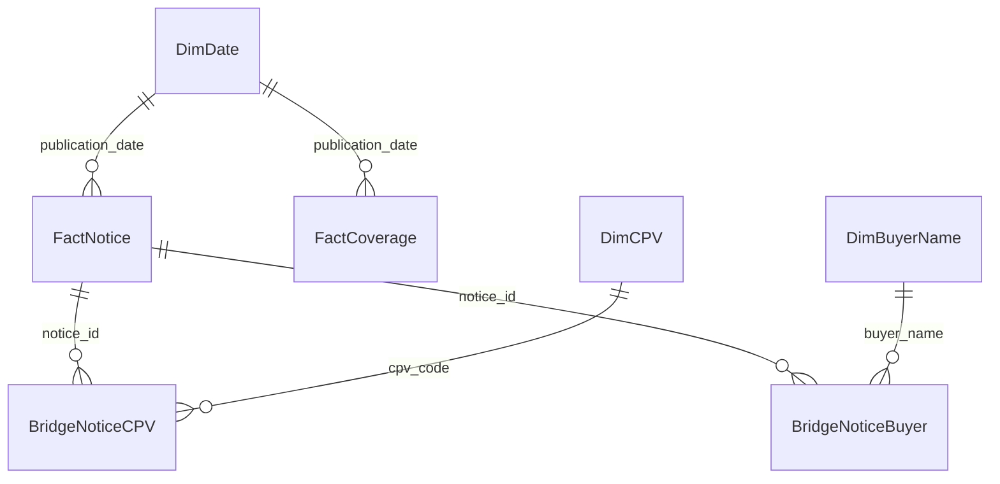

# Power BI Desktop starter

The report reads one reviewed local history snapshot. It does not query Azure,
change the watermark or require publication to the Power BI service.

## Open the report

From the repository root, after building a snapshot as described in [history.md](history.md):

```powershell
uv run python scripts/prepare_powerbi.py `
  --snapshot data/history/verified-nov12-14 `
  --output data/powerbi/starter
```

Open `data/powerbi/starter/TenderScope.pbip` in Power BI Desktop and select
**Refresh**. If Desktop offers to convert the model to TMDL when saving,
choose **Do not upgrade** to retain the template format. The helper verifies checksums for the four imported Parquet files
and sets the local `SourceFolder` Power Query parameter in a copy of the project.
Use a new output directory for another snapshot. Keep the source snapshot intact:
Desktop reads it again on refresh; checksum validation happens when preparing the
project, not inside Power Query.

The tracked `powerbi/` project is a template with a placeholder path. Local data,
model caches, user settings and PBIX exports are excluded from Git.

## Model and measures



- **FactNotice** has one row per notice ID, not per contract or procurement procedure.
- **FactCoverage** has one row per complete source day, including zero-notice days.
- Buyer names are source strings, not resolved legal entities.
- Relationships filter in one direction. The `Notices` measure applies selected
  CPV and buyer names through `TREATAS`; selecting both uses their intersection.
- `Notices` counts distinct IDs. An announcement can belong to several CPV codes,
  so adding category counts can exceed the overall total.
- `Covered days` follows the date selection, independently of CPV and buyer filters.
- `Notices per covered day` includes verified empty days in its denominator.
  It is not an estimate for days outside the snapshot.

The date dimension contains only covered dates. No missing day is invented as
zero. The starter intentionally has no year-over-year metrics, monetary totals,
contract-award conclusions or market-wide coverage claims.

## Report pages

**Overview** contains three measures, a date selector, daily counts, CPV counts
and notice types. The CPV table supports selecting a category to filter the measures.
**Details** lists notice IDs, dates, titles, types and source run IDs. Page selections
are independent; this version does not implement drillthrough or synced slicers.

## Acceptance check

For the initial reviewed snapshot (12–14 November 2026):

1. Refresh loads 53 notices and 3 covered days.
2. Daily counts are 27, 26 and 0; average is 17.67.
3. Selecting 14 November shows 0 notices, 1 covered day and average 0.
4. Selecting a CPV counts distinct notice IDs; clearing it restores the total.
5. The details page shows source run IDs so a row can be traced back to Silver.

Verified in Power BI Desktop on 16 November 2026: import completed, the overview
returned 53 notices / 3 days / 17.67, category selection changed the measures, and
the details page displayed the imported notice rows. The [acceptance DAX query](powerbi-acceptance.dax)
returned `53, 3, 27, 26, 0, 15, 6, TRUE`, matching independent Parquet counts.
Paste it into Desktop's DAX query view to repeat the check on the initial snapshot.
Its expected values must be revised when the snapshot date range changes.

Automated Python checks cover preparation safeguards. They do not execute DAX
or validate the Desktop rendering; those require opening and refreshing the project.

## Next increment

Extend the reviewed history with a supervised backfill, then add meaningful trends.
Add CPV labels from a versioned reference, a buyer selector and detail drillthrough
when needed. Publishing and scheduled refresh are separate decisions with their
own access and cost requirements.

The file layout follows Microsoft's [Power BI project report format](https://learn.microsoft.com/en-us/power-bi/developer/projects/projects-report)
and [semantic model format](https://learn.microsoft.com/en-us/power-bi/developer/projects/projects-dataset).
