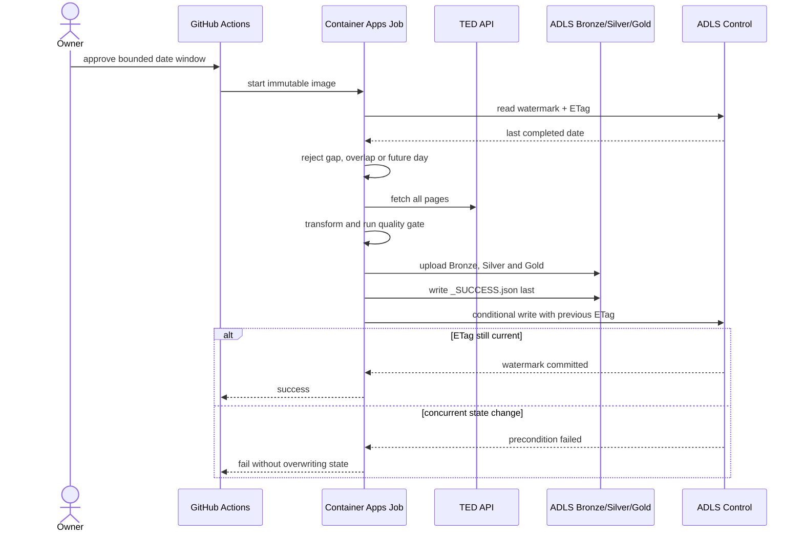
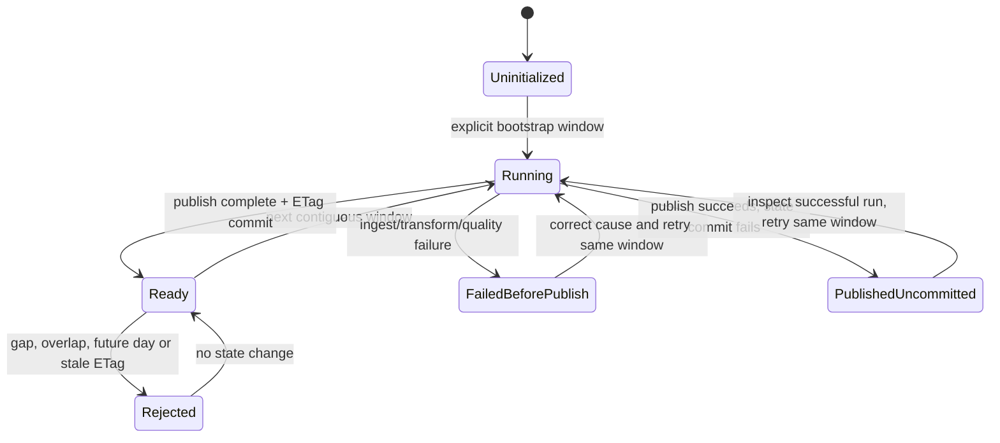

# Durable incremental state and recovery

TenderScope keeps execution manual and approval-gated, but it does not rely on an operator to remember the next date. A versioned watermark in the private ADLS `control` container records the last fully published date for each logical stream.

The default stream is `ted-poland-it`. Its state is stored at `control/state/ted-poland-it.json`.

## Commit protocol



This is an **at-least-once publication protocol**. A process can fail after `_SUCCESS.json` but before the state commit. In that narrow case, the same date may be republished under a new run ID, but the watermark never advances without complete data and never silently skips a date. Consumers should use `_SUCCESS.json` and the recorded run ID as their completion boundary.

## State contract

```json
{
  "schema_version": 1,
  "stream": "ted-poland-it",
  "last_completed_date": "2026-11-12",
  "last_run_id": "ted_20261114T220000000000Z",
  "updated_at_utc": "2026-11-14T22:00:12+00:00"
}
```

The reader rejects an unsupported schema version, invalid stream name, malformed date, blank run ID or timestamp without a timezone. State changes use the ETag returned by the read. An update succeeds only if that ETag is still current; the first write succeeds only if the state file does not already exist.

## Invariants

1. A new stream must be bootstrapped with an explicit `since` date.
2. After bootstrap, every window starts exactly one day after `last_completed_date`.
3. An incremental window contains one to seven inclusive days.
4. The window may contain completed UTC days only.
5. Partial ingestion is not permitted for a state-advancing run.
6. The watermark is committed after all quality checks, all layer uploads and `_SUCCESS.json`.
7. A stale writer fails instead of overwriting newer state.

## State transitions



## Failure and recovery matrix

| Failure point | Published data | Watermark | Operator action |
| --- | --- | --- | --- |
| TED request or pagination | No complete run | Unchanged | Retry the same window; ingestion retry/resume remains available locally |
| Silver transform or quality gate | No cloud publication | Unchanged | Fix the data/code issue and retry the same window |
| ADLS layer upload | Possible incomplete files, no `_SUCCESS` | Unchanged | Retry; consumers ignore the incomplete run |
| `_SUCCESS` written, process exits before state commit | Complete run exists | Unchanged | Verify the marker, then retry the same window; duplicate run IDs are safe but should be recorded |
| ETag precondition fails | Complete run may exist | Preserved from the winning execution | Inspect both run IDs and continue from the current watermark |
| Invalid requested dates | None | Unchanged | Use the exact next date shown in the error |

## First dev rollout

The `control` container and its runtime role assignment must exist before enabling the state-enforced workflow. After merging:

1. run the documented Bicep `what-if` with the job's current image override;
2. confirm the plan only adds the `control` container, its scoped runtime role and expected code-defined updates;
3. apply the reviewed Bicep deployment;
4. run `Deploy dev` and approve the protected environment;
5. bootstrap `Run ETL dev` with the first date after the last verified cloud batch.

The last verified batch completed `2026-11-11`, so the planned bootstrap window is `2026-11-12` through `2026-11-12`. After that succeeds, the next accepted start date is `2026-11-13`.

Never create or edit the state JSON manually during routine operation. A manual repair is a production incident: preserve the current file and ETag, identify the corresponding `_SUCCESS.json`, document the decision, and apply a reviewed conditional update.
